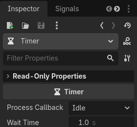
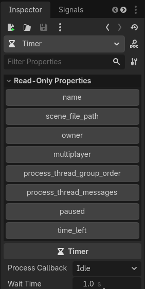

# Object Property Inspector Plugin

This project was created to help someone looking to list read-only properties of nodes and display tooltips when hovering.
It is a simple EditorInspectorPlugin with a custom layered control which filters an object's properties by usage flag.

